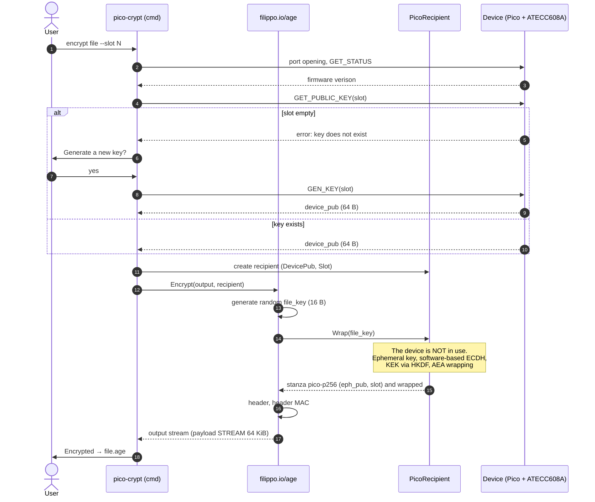
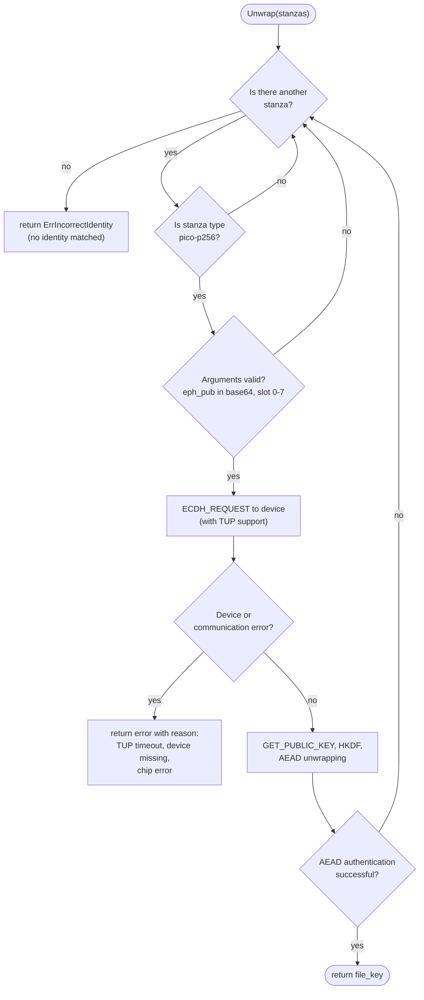

# Integration with the age format

The document describes how `pico-crypt` integrates the **age** format with the ATECC608A hardware key: the custom `pico-p256` stanza type, key derivation, encryption and decryption workflows, the CLI interface, compatibility with standard `age`, and implementation pitfalls.

## Spis treści

- [Integration with the age format](#integration-with-the-age-format)
  - [Spis treści](#spis-treści)
  - [1. Assumptions and scope](#1-assumptions-and-scope)
  - [2. Why a custom stanza type?](#2-why-a-custom-stanza-type)
  - [3. Recap: age file structure](#3-recap-age-file-structure)
  - [4. `pico-p256` stanza specification](#4-pico-p256-stanza-specification)
    - [4.1 Format](#41-format)
    - [4.3 Versioning](#43-versioning)
  - [5. Wyprowadzenie klucza](#5-wyprowadzenie-klucza)
    - [5.1 Comparison with the AGE Convention](#51-comparison-with-the-age-convention)
    - [5.2 What the KDF does not link](#52-what-the-kdf-does-not-link)
  - [6. Encryption flow](#6-encryption-flow)
    - [6.1 Sequence diagram](#61-sequence-diagram)
    - [6.2 Notes](#62-notes)
  - [7. Decryption flow](#7-decryption-flow)
    - [7.1 Sequence diagram](#71-sequence-diagram)
    - [7.2 `Unwrap` logic (handling multiple states and errors)](#72-unwrap-logic-handling-multiple-states-and-errors)
    - [7.3 Notes](#73-notes)
  - [8. Implementation in Go](#8-implementation-in-go)
    - [8.1 Module layout](#81-module-layout)
    - [8.2 age interfaces](#82-age-interfaces)
    - [8.3 `Unwrap` implementation rules](#83-unwrap-implementation-rules)
    - [8.4 Device interface](#84-device-interface)
  - [9. CLI interface](#9-cli-interface)
  - [10. Structural safety analysis](#10-structural-safety-analysis)
  - [11. Implementation pitfalls](#11-implementation-pitfalls)
  - [12. Possible extensions](#12-possible-extensions)
  - [Related documents](#related-documents)

---

## 1. Assumptions and scope

- The encrypted file is a **valid `age` file**: the header, stanzas, header MAC, and STREAM payload are generated by the `filippo.io/age` library. Only the **recipient type** (`age.Recipient`) and **identity** (`age.Identity`) are custom implementations.
- **The user does not manage public keys.** The key is retrieved from the chip (or generated upon first use), and the slot number is stored in the stanza.
- Hardware limitation: The ATECC608A supports only the **P-256** curve, so the standard `X25519` stanza cannot be used.

## 2. Why a custom stanza type?

`age` uses X25519 as the default recipient type. The chip does not support X25519, and the P-256 and Curve25519 curves represent different mathematical groups. Three options were considered:

| Option | Description | Pros | Cons |
|---|---|---|---|
| **A (chosen)** | Custom `pico-p256` stanza type | Private key never leaves the chip; proper ECDH | File incompatible with standard `age` without a plugin |
| B | X25519 key encrypted in a data slot | Compatibility with standard `age` | Key must leave the chip during the operation, negating the main advantage |
| C | Chip acts as PIN guardian; X25519 key in RP2040 flash | Compatibility with standard `age` | Key stored in flash memory, resulting in lower security |

Option A follows the same pattern used by `age-plugin-yubikey` (the YubiKey PIV applet also uses P-256, hence the custom `piv-p256` stanza type).

## 3. Recap: age file structure

```
age-encryption.org/v1                      ← version header
-> <stanza type> <arg1> <arg2> …            ← one stanza per recipient
<stanza body, base64, lines ≤ 64 chars>
--- <header MAC, base64>                   ← header HMAC-SHA256
<nonce 16 B><chunk 1><chunk 2>…            ← payload: STREAM ChaCha20-Poly1305
```

- The file key (`file_key`, 16 B) is random. Each stanza contains the `file_key` wrapped with the recipient's key.
- The header MAC (key derived from `file_key`) protects the integrity of the entire header, including the stanzas. It is verified by the library after the `file_key` is recovered.
- The payload consists of 64 KiB blocks, each with a 16-byte Poly1305 tag. Any modification to a block causes the entire payload to be rejected.

Full specification: <https://age-encryption.org/v1>.

## 4. `pico-p256` stanza specification

### 4.1 Format

```
-> pico-p256 <eph_pub> <slot>
<wrapped_file_key>
```

| Element | Encoding | Content |
|---|---|---|
| `pico-p256` | text | stanza type |
| `eph_pub` | unpadded base64 (RFC 4648) | sender's ephemeral public key, P-256 point (uncompressed format) |
| `slot` | decimal number 0–7 | ATECC608A slot number containing the recipient's private key |
| `wrapped_file_key` | stanza body (base64 added by library) | AEAD-encrypted `file_key`: 16 B ciphertext + 16 B tag = **32 B** |

Stanza arguments must not contain whitespace. Unpadded base64 values ​​satisfy this requirement.

### 4.3 Versioning

Changing the wrapping algorithm, KDF, or argument format requires a **new stanza type** (e.g., `pico-p256-v2`), not a change to the semantics of an existing one. Files encrypted with an older type remain readable as long as the tool recognizes that type.

## 5. Wyprowadzenie klucza

```
shared   = ECDH(eph_priv, device_pub)                 32 B (X coordinate)
KEK      = HKDF-SHA256( IKM  = shared,
                        salt = (empty),
                        info = eph_pub ‖ device_pub ‖ "age-encryption.org/v1/pico-p256" )
                        → 32 B
wrapped  = AEAD_Encrypt(KEK, nonce = 0, plaintext = file_key)   → 32 B (16 + tag 16)
```

The parameters used in both directions must be **identical byte-for-byte** (the same point representation, the same concatenation order, the same label).

### 5.1 Comparison with the AGE Convention

The standard `X25519` stanza in age uses a different arrangement of HKDF parameters: `salt = eph_share ‖ recipient`, `info = "age-encryption.org/v1/X25519"`, and wraps the key using ChaCha20-Poly1305 with a zero nonce.

`pico-p256` places public keys in `info` and leaves the salt empty. Both variants are valid under the HKDF model (RFC 5869): both `salt` and `info` are explicit, and both can provide domain separation.

### 5.2 What the KDF does not link

- **Slot number.** The `slot` is not included in the HKDF. Swapping it in the header causes a different private key to be used, resulting in AEAD authentication failure without leaking information. The outcome is, at most, a refusal to decrypt and an additional TUP request.
- **Sender identity.** age does not authenticate the sender, and neither does `pico-p256`.

## 6. Encryption flow

### 6.1 Sequence diagram



### 6.2 Notes

- Once the public key has been retrieved (the part of the diagram involving messages sent to the device), **the device is no longer needed**. Encrypting large files places no load on the chip or the USB connection.
- The slot recorded in the state is the only information about the device contained in the file.
- Key generation (the `alt` branch) is an **irreversible** operation for a given slot and requires user confirmation.

## 7. Decryption flow

### 7.1 Sequence diagram

```mermaid
sequenceDiagram
    autonumber
    actor U as User
    participant CLI as pico-crypt (cmd)
    participant AGE as filippo.io/age
    participant ID as PicoIdentity
    participant DEV as Device (Pico + ATECC608A)

    U->>CLI: decrypt file.age
    CLI->>DEV: port opening, GET_STATUS
    CLI->>AGE: Decrypt(input, identity)
    AGE->>AGE: parse header
    AGE->>ID: Unwrap(stanzas)

    loop for every pico-p256 stanza (until successful)
        ID->>ID: read eph_pub (Args[0]) and slot (Args[1])
        ID->>DEV: ECDH_REQUEST(slot, eph_pub)
        DEV-->>ID: PENDING (10s TUP window)
        ID-->>CLI: button press required
        CLI->>U: Touch the button on the device

        loop every 500 ms, max. 25 attempts
            ID->>DEV: ECDH_REQUEST (retry)
            DEV-->>ID: PENDING
        end

        U->>DEV: button press
        ID->>DEV: ECDH_REQUEST (retry)
        DEV-->>ID: shared_secret (32 B)
        ID->>DEV: GET_PUBLIC_KEY(slot)
        DEV-->>ID: device_pub (64 B)

        ID-bound key: KEK via HKDF,<br/>AEAD unwrapping

        alt authentication correct 
            ID-->>AGE: file_key 
        else authentication error 
            Note over ID: this is the wrong identity,<br />next stanza 
        end
    end

    AGE->>AGE: header MAC verification
    AGE-->>CLI: decrypted data stream (STREAM)
    CLI->>U: Decrypted → file
```

The diagram simplifies the chronology: the button press occurs during the retry loop, and the loop terminates when the device returns a result instead of `PENDING`.

### 7.2 `Unwrap` logic (handling multiple states and errors)



Rules shown in the diagram:

- stanzas of other types and stanzas with malformed arguments are **skipped** and do not interrupt decryption (multi-recipient file),
- an authentication error signifies a "different identity" and leads to the next stanza,
- a device or communication error is returned **as an error with a specific cause** rather than a mismatch, so that the user sees the actual problem.

### 7.3 Notes

- **One ECDH operation per file**, regardless of size. Decryption time consists of a fixed chip overhead (~78 ms) plus the time required to decrypt the payload on the host.
- The slot is read from the file, so `decrypt` does not accept the `--slot` option.
- An authentication error resulting from a different device or a modified stanza is reported as `age.ErrIncorrectIdentity` ("no identity matched any of the recipients"). Modifying the payload after a valid header results in a block authentication error and returns no data.

## 8. Implementation in Go

### 8.1 Module layout

```
age-go-client/
├── main.go                       command routing
├── cmd/                          encrypt.go, decrypt.go, list_keys.go
├── internal/
│   ├── device/                   communication with Pico (USB CDC, protocol)
│   ├── protocol/                 command codes
│   ├── tui/                      TUI handling
│   └── picoage/
│       ├── recipient.go          PicoRecipient (age.Recipient)
│       ├── identity.go           PicoIdentity (age.Identity)
│       └── crypto.go             hkdfDerive, aeadWrap, aeadUnwrap
└── benchmarks/bench_test.go
```

### 8.2 age interfaces

```go
// age.Recipient
Wrap(fileKey []byte) ([]*age.Stanza, error)

// age.Identity
Unwrap(stanzas []*age.Stanza) (fileKey []byte, err error)

// age.Stanza
type Stanza struct {
    Type string
    Args []string
    Body []byte
}
```

`PicoRecipient` contains `DevicePub` and `Slot`. Its `Wrap` method performs ECDH in software. `PicoIdentity` holds a handle to the device, and `Unwrap` reads the `slot` from the stanza and requests ECDH from the device.

### 8.3 `Unwrap` implementation rules

- Process only `pico-p256` type stanzas; skip the others (`continue`). This ensures that multi-recipient files are handled correctly.
- Skip stanzas with an incorrect number or format of arguments rather than aborting with an error; a malformed stanza for another recipient should not block decryption.
- An AEAD authentication error for a stanza implies "this is not the correct identity"—proceed to the next one. If none match, return `age.ErrIncorrectIdentity`.
- Return device communication errors as actual errors rather than a "no match" result, so the user sees the true cause.
- Zero out `shared` and `KEK` after use.

### 8.4 Device interface

Dla testowalności ukryj urządzenie za małym interfejsem:

```go
type Device interface {
    GetPublicKey(slot uint8) ([]byte, error)   // 64 B
    GenerateKey(slot uint8) ([]byte, error)    // 64 B
    ECDH(slot uint8, peerPub []byte) ([]byte, error) // peerPub 64 B → 32 B
}
```

This allows testing `Wrap`/`Unwrap` with a mock based on `crypto/ecdh`.

## 9. CLI interface

| Command | Description |
|---|---|
| `pico-crypt encrypt <file> [--slot N] [--port P]` | encrypts to `<file>.age`; default slot is 0 |
| `pico-crypt decrypt <file.age> [--port P]` | decrypts; slot taken from header |
| `pico-crypt list-keys [--port P]` | shows which slots (0–7) contain keys (fingerprint: 8-byte SHA-256 of the public key) |
| `pico-crypt gen-key [--slot N] [--port P]` | forces key generation in the specified slot (irreversible) |
| `--port P` | serial port; defaults to auto-detecting `/dev/ttyACM*` |

Behaviors:

- **First use** of `encrypt` with an empty slot: prompts "Generate new key?" and generates it upon confirmation.
- **Existing output file:** prompts to overwrite instead of silently overwriting.
- **Decryption:** displays a message requiring a button press.
- **Error messages:** device missing (`Pico not found`), identity rejected (`incorrect identity`), TUP timeout, payload authentication error. Details in [`protocol.md`](protocol.md).

## 10. Structural safety analysis

**What it provides:**

- confidentiality of the `file_key` against a ciphertext holder lacking the private key (ECDH P-256 with an ephemeral key, AEAD),
- `KEK` uniqueness (a fresh ephemeral key per file),
- header and payload integrity (age header MAC and AEAD STREAM),
- absence of a recipient identifier in the header, other than the slot number and ephemeral key. The slot does not represent the recipient's identity but reveals **which device slot** was used.

**What it does not provide:**

- sender authentication,
- protection against active malware on the host during decryption (`shared_secret` exposed via USB),
- formal analysis of the design. `pico-p256` is a custom composition of standard primitives and **has not undergone peer review**.

Full threat model: [`security-model.md`](security-model.md). The impact on the thesis statement is described in [`limitations.md`](limitations.md): the resilience of the **age format** does not automatically extend to this custom design.

## 11. Implementation pitfalls

I identified the following issues in the code drafts from the plan. Check if they apply to the final version.

| # | Issue | Consequence | Solution |
|---|---|---|---|
| 1 | `ecdh.P256().NewPublicKey(r.DevicePub)` with a 64-byte key | error: `crypto/ecdh` requires the `0x04 ‖ X ‖ Y` format (65 B) | prepend `0x04` before the call |
| 2 | Passing a 65-byte point to `Device.ECDH` | `copy` to a 65-byte buffer (`[slot] + 64 B`) truncates the last byte of `Y` and sends `0x04 ‖ X ‖ Y[:31]`, i.e., an **invalid point** | remove the `0x04` prefix and pass exactly `X ‖ Y` (64 B) |
| 3 | Inconsistent point format in HKDF (`info`) on the encryption and decryption sides | `KEK` mismatch; `Unwrap` always fails | define a canonical format (4.2) and use it on both sides |
| 4 | `list-keys` draft does not import `strings` and `crypto/sha256` | compilation error | add missing imports |
| 5 | `benchmarks/bench_test.go` calls `io.Copy`/`io.Discard` without importing `io` | compilation error | add the import |
| 6 | `inspect_age` draft uses `bufio.Scanner` and `f.Seek` on the same file | file position after scanning is unpredictable (scanner buffer) | calculate offset manually or read header via `bufio.Reader` |
| 7 | Failure to zero out `shared` and `KEK` | secret remains in memory | zero out after use |
| 8 | Missing TUP timeout handling in `Unwrap` | user sees a generic error | map `ERR_USER_PRESENCE_TIMEOUT` and retry limit to a readable message |
| 9 | `Unwrap` aborts on error in a single stanza | prevents decryption of multi-recipient files | see 8.3 |

## 12. Possible extensions

- **age plugin (`age-plugin-pico`).** The age plugin protocol would allow using the standard `age` CLI with a hardware key and an identity of the type `AGE-PLUGIN-PICO-1…`. The current `Recipient`/`Identity` implementation could be wrapped in a plugin without changing the stanza format.
- **Moving the `slot` into the KDF** to cryptographically bind it to the wrapping key (currently unnecessary, but results in a cleaner design).
- **Compressed point representation** in the stanza to shorten the header. Requires decompression on the host side before sending to the device.
- **Displaying the key fingerprint** during encryption (see [`security-model.md`](security-model.md)).

---

## Related documents

- [`architecture.md`](architecture.md): components, client layers, and design decisions
- [`protocol.md`](protocol.md): `GET_PUBLIC_KEY`, `ECDH_REQUEST`, and `GEN_KEY` commands, TUP
- [`security-model.md`](security-model.md): threats and format analysis
- [`limitations.md`](limitations.md): limitations of the `pico-p256` design
- [`reproducibility.md`](reproducibility.md): build process and benchmarks