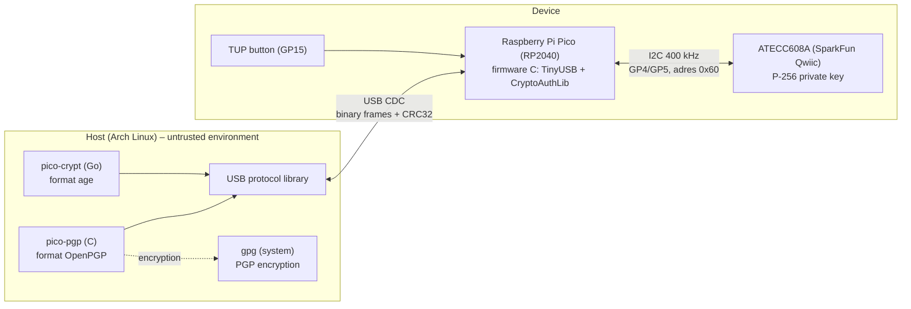
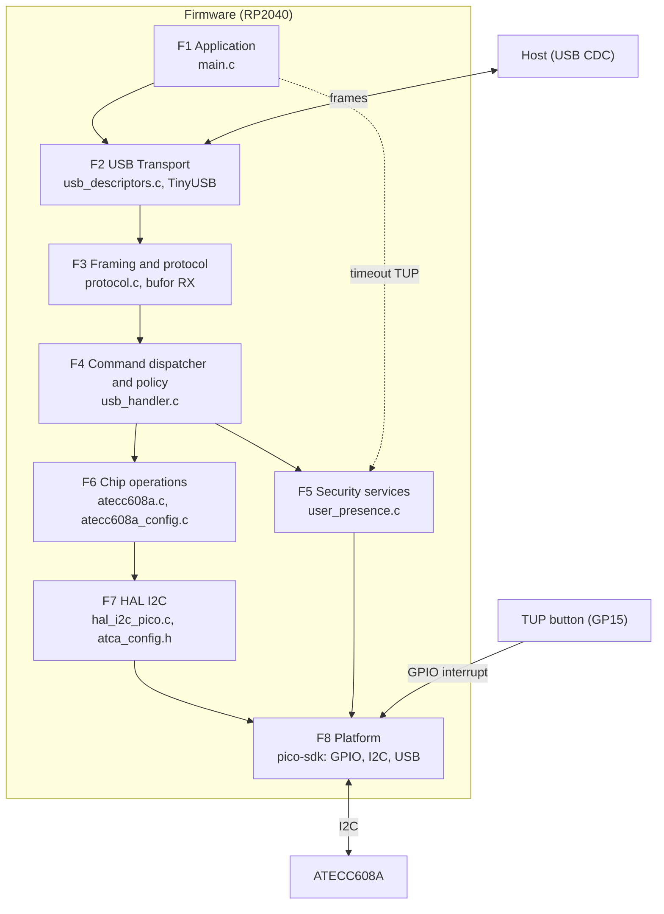
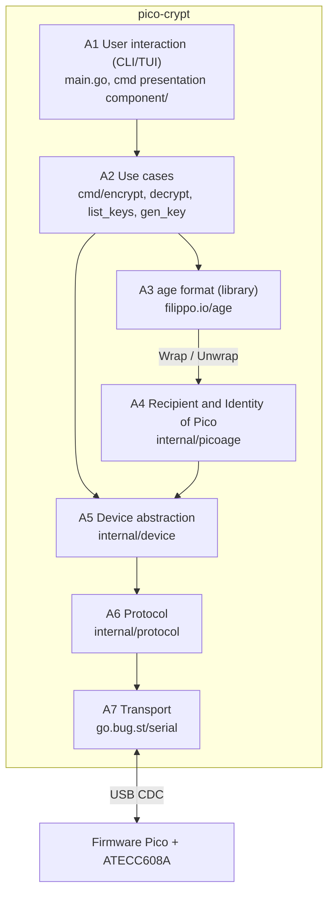
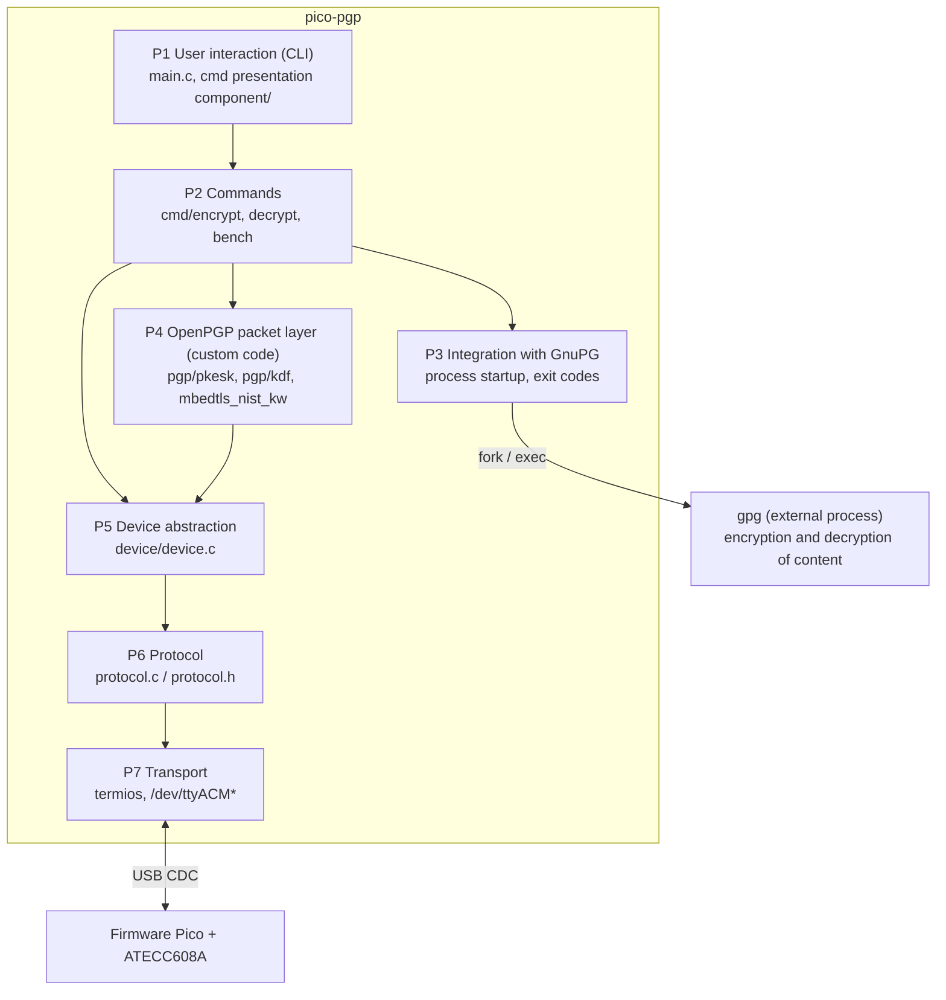

# System architecture

This document describes the architecture, data flows, and design decisions for a file encryption device based on the Raspberry Pi Pico and ATECC608A, as well as the accompanying host tools (`pico-crypt`, `pico-pgp`).

> **Status:** Research prototype from a master's thesis.

## Table of Contents

- [System architecture](#system-architecture)
  - [Table of Contents](#table-of-contents)
  - [1. Purpose and scope](#1-purpose-and-scope)
  - [2. General view](#2-general-view)
  - [3. Components](#3-components)
  - [4. Firmware](#4-firmware)
    - [4.1 Layers](#41-layers)
    - [4.2 Command path through the layers](#42-command-path-through-the-layers)
    - [4.3 Key implementation details](#43-key-implementation-details)
  - [5. Client layers](#5-client-layers)
    - [5.1 `pico-crypt` (age, Go)](#51-pico-crypt-age-go)
    - [5.2 `pico-pgp` (C + GnuPG)](#52-pico-pgp-c--gnupg)
  - [6. Key management and slots](#6-key-management-and-slots)
  - [7. Design decisions](#7-design-decisions)
    - [7.1. P-256 instead of X25519](#71-p-256-instead-of-x25519)
    - [7.2. ECDH in *output in clear* mode](#72-ecdh-in-output-in-clear-mode)
    - [7.3. Standalone CLI instead of the age plugin](#73-standalone-cli-instead-of-the-age-plugin)
    - [7.4. OpenPGP: GPG for encryption, custom code only for decryption.](#74-openpgp-gpg-for-encryption-custom-code-only-for-decryption)
  - [8. Architectural limitations](#8-architectural-limitations)
  - [Related documents](#related-documents)

---

## 1. Purpose and scope

**Goal:** File encryption and decryption using a private key stored in a secure element, from which the key cannot be read.

**Key assumption:** The device **does not encrypt files itself**. It performs a single operation—**ECDH on the P-256 curve**—using the private key locked within the ATECC608A. The host handles everything else (key derivation, AEAD/CFB encryption, file format construction).

**Out of scope:**

- protection against a fully compromised host during decryption (see [8](#8-architectural-limitations)),
- FIDO/Common Criteria certification,
- compatibility with the standard age CLI (the `pico-p256` format requires a custom tool).

## 2. General view

## 3. Components

| Component | Language / technology | Responsibility |
|---|---|---|
| `firmware/` | C, pico-sdk, TinyUSB, CryptoAuthLib | USB CDC handling, frame parser, I2C HAL, chip cryptographic commands, TUP |
| ATECC608A | Secure element | P-256 key generation, ECDH, hardware RNG; private key never leaves the chip |
| `host/` | C | Protocol library (`protocol.c`, `device.c`), unit and integration tests |
| `pico-crypt/` | Go, `filippo.io/age` | CLI for the age format: `PicoRecipient` (encryption), `PicoIdentity` (decryption) |
| `pico-pgp/` | C, mbedTLS | CLI for OpenPGP: certificate generation, PKESK/SEIPD parser, KDF, decryption |

## 4. Firmware

### 4.1 Layers

Firmware runs on a single RP2040 core, without a real-time operating system. The code is organized into layers with strictly downward dependencies. The following description covers only the program structure. The frame format is described in [`protocol.md`](protocol.md), and the chip configuration in [`hardware.md`](hardware.md).

| Layer | Module | Responsible for |
|---|---|---|
| **F1 Application** | `main.c` | Initialization (stdio, TinyUSB, button/LED GPIO, CryptoAuthLib), main loop (`tud_task()`, checking TUP window expiration) |
| **F2 USB Transport** | `usb/usb_descriptors.c`, TinyUSB | Device descriptors (VID `0x2E8A`, PID `0x000A`, CDC class), byte reception (`tud_cdc_rx_cb`), writing and flushing the transmit buffer (`tud_cdc_write`, `tud_cdc_write_flush`) |
| **F3 Framing and Protocol** | `crypto/protocol.c`, RX buffer in `usb_handler.c` | Frame assembly from fragments (256 B buffer), detecting incomplete/corrupted frames, resynchronization to `STX`, checking `LEN` and CRC32, constructing response and error frames |
| **F4 Command Dispatcher and Policy** | `usb/usb_handler.c` (`handle_*`) | Selecting command procedure, payload validation (length, slot range, zero point), **TUP gate** before sensitive operations, mapping chip errors to protocol codes, sending responses, zeroing secrets after use |
| **F5 Security Services** | `crypto/user_presence.c` | **TUP**: GPIO interrupt handling, 50 ms debounce, 10 s window, `volatile` flags, memory zeroing |
| **F6 Chip Operations** | `crypto/atecc608a.c`, `crypto/atecc608a_config.c` | thin wrappers around CryptoAuthLib (`atcab_ecdh`, `atcab_get_pubkey`, `atcab_genkey`, `atcab_random`, `atcab_info`), configuration zone reading and verification |
| **F7 HAL I2C** | `crypto/hal_i2c_pico.c`, `crypto/atca_config.h` | CryptoAuthLib adapter for the RP2040 API: address conversion (`0xC0` → `0x60`), wake sequences (temporarily lowering speed to 100 kHz), idle and sleep modes, send/receive operations, I2C error mapping |
| **F8 Platform** | pico-sdk (`hardware_i2c`, `hardware_gpio`, `pico_stdlib`) | access to RP2040 hardware: I2C, GPIO and interrupts, timing |

### 4.2 Command path through the layers

Below is only the request path through the layers, without cryptographic details.

| Step | Layer | Event |
|---|---|---|
| 1 | F2 | TinyUSB calls `tud_cdc_rx_cb` with new bytes |
| 2 | F3 | Bytes enter the RX buffer. If the frame is complete and the CRC is valid, a `frame_t` structure is created |
| 3 | F4 | The dispatcher selects the `handle_*` function for the `CMD` and validates the payload |
| 4 | F4 + F5 | For sensitive operations: TUP check. Lack of authorization results in a `PENDING` response or an error, without invoking the chip |
| 5 | F6 | Chip function invocation (e.g., ECDH) |
| 6 | F7 | CryptoAuthLib via HAL: wake, send command, wait, read result, return to sleep |
| 7 | F4 | Conversion of result or error to protocol code, zeroing out the secret |
| 8 | F3 + F2 | Construction of response frame with CRC and transmission via `tud_cdc_write` with buffer flush |

### 4.3 Key implementation details

- **I2C Addressing.** The SparkFun breakout responds to the 7-bit address `0x60`. CryptoAuthLib stores this in 8-bit format (`0xC0`), so the HAL performs a right shift before calling the RP2040 API.
- **Wake Sequence.** The wake token requires the SDA line to be held low for at least 60 µs; at 400 kHz, this cannot be achieved within a single byte transmission. To perform the wake operation, the HAL lowers the clock speed to 100 kHz, waits for the tWHI duration (1.5 ms), and then reverts to 400 kHz.
- **Frame Assembly.** USB may deliver frames in fragments. The parser distinguishes between an incomplete frame (waiting for more data) and a corrupted one (resynchronizing to the next `STX` byte).
- **Button ISR.** The GPIO callback merely sets `volatile` flags; it does not call I2C, TinyUSB, or `printf`. A 50 ms software debounce is implemented.

## 5. Client layers

A client is a program running on the host that connects the user, the file format, and the device. The project features two clients:

- **`pico-crypt`** (Go): **age** format,
- **`pico-pgp`** (C + GnuPG): **OpenPGP** format.

Both use the same firmware and the same USB protocol. They differ in terms of format, implementation language, and which component performs the cryptographic operations. The **layering and division of responsibilities** are described below. Cryptographic steps (ECDH, KDF, key wrapping) are detailed in [`age-integration.md`](age-integration.md) and [`pgp-integration.md`](pgp-integration.md).

### 5.1 `pico-crypt` (age, Go)

| Layer | Package | Responsible for |
|---|---|---|
| **A1 User interaction (CLI/TUI)** | `main.go`, presentation part of `cmd/` | parsing commands and flags (`--slot`, `--port`), interactive confirmations (generate key? overwrite file?), status messages ("Connected to Pico…", "Press the button…"), `list-keys` table with fingerprints, mapping errors to readable messages and exit codes |
| **A2 Use cases** | `cmd/` | scenarios: retrieving a key or proposing its generation, selecting filenames, constructing recipient and identity objects, invoking `age.Encrypt`/`age.Decrypt`, policy (default slot 0, slot determined by file header during decryption) |
| **A3 age format** | `filippo.io/age` | **file content encryption and decryption**: header, header MAC, file key generation, ChaCha20-Poly1305 stream |
| **A4 Pico recipient and identity** | `internal/picoage` | **file key wrapping and unwrapping**: `PicoRecipient.Wrap` (encryption, programmatic), `PicoIdentity.Unwrap` (decryption, using the device), reading and writing the `pico-p256` stanza, zeroing out secrets |
| **A5 Device abstraction** | `internal/device` | **device communication** in terms of operations (`GetPublicKey`, `GenerateKey`, `ECDH`), port auto-detection, timeouts, retries, TUP wait loop, mapping firmware error codes to Go errors (`ErrKeyNotFound`, TUP timeout) |
| **A6 Protocol** | `internal/protocol` | command codes, frame construction and parsing, CRC32, size limits ([`protocol.md`](protocol.md)) |
| **A7 Transport** | `go.bug.st/serial` | serial port opening and handling |

### 5.2 `pico-pgp` (C + GnuPG)

| Layer | File | Responsible for |
|---|---|---|
| **P1 User Interaction (CLI)** | `main.c`, presentation part of `cmd/` | parsing commands and options (`--slot`, `--port`, `--fp`), status and error messages, "press button" prompt, exit codes. **No TUI layer**, text-only messages |
| **P2 Commands** | `cmd/*.c` | scenarios: `encrypt`, `decrypt`, `bench` (certificate generated by separate script `gen_cert.py`). Checking if `pico@device` certificate is in the keyring, loading the fingerprint file, determining output filename |
| **P3 GnuPG Integration** | `cmd/` (process calls) | launching `gpg` (encryption: `--encrypt`, decryption: `--decrypt` with passed session key), interpreting exit codes (including MDC error), handling file streams |
| **`gpg`** (external process) | GnuPG 2.4.x | **content encryption** (session key selection, SEIPD with AES-CFB and MDC, key wrapping during encryption), **content decryption** (SEIPD, MDC verification) |
| **P4 OpenPGP Packet Layer** | `pgp/pkesk.c`, `pgp/kdf.c`, `mbedtls_nist_kw` | **session key recovery during decryption**: PKESK packet parser, KDF, AES Key Unwrap, checksum and padding verification, zeroing out secrets. `gen_cert.py` (pgpy) generates the certificate from the device key |
| **P5 Device abstraction** | `device/device.c` | **device communication**: opening the port, sending commands and receiving responses, retries on TUP, timeouts |
| **P6 Protocol** | `protocol.c`, `protocol.h` | command codes, frame construction and parsing, CRC32 |
| **P7 Transport** | `termios` | serial port raw mode |

## 6. Key management and slots

| Slot | Application |
|---|---|
| 0 | Device default key (ECC P-256, ECDH allowed) |
| 1–7 | Additional keys (work context, backup, fallback) |
| 8 | Data slot (416 B): optional OpenPGP certificate |

ECDH slot configuration (`SlotConfig` / `KeyConfig`):

- `ECDH` allowed, `IsSecret = 1`, `KeyType = P-256`, `PubInfo = 1`,
- bit `WRITE_ECDH = 0`, i.e. **ECDH result is output explicitly via I2C** (`atcab_ecdh()`).

`GenKey` in creation mode **irreversibly destroys** the previous key in the slot, which is why the tools ask for confirmation.

> **Note on `Lock`:** locking the configuration zone is irreversible.

## 7. Design decisions

### 7.1. P-256 instead of X25519
The ATECC608A supports only P-256. Three options were considered:

| Option | Description | Drawbacks |
|---|---|---|
| **A (chosen)** | Custom `pico-p256` stanza type | Files incompatible with standard `age` |
| B | X25519 key in the chip's data slot | Key must leave the chip, negating the main advantage |
| C | Chip acts as PIN guardian; key in RP2040 flash | Key in flash memory, resulting in lower security |

The `age-plugin-yubikey` uses the same approach (`piv-p256` stanza).

### 7.2. ECDH in *output in clear* mode
The alternative approach (writing the result to slot N+1 and using `ecdh_ioenc` encrypted reading) requires an I/O protection key and significantly complicates the configuration. Since the secret must reach the host regardless, and the USB channel is unencrypted, encrypting the I2C communication itself does not alter the threat model in this architecture.

### 7.3. Standalone CLI instead of the age plugin
The user does not manage public keys or Bech32 encoding. The key is retrieved from the chip or generated upon first use, and the slot number is stored in the stanza. Trade-off: no interoperability with standard `age`.

### 7.4. OpenPGP: GPG for encryption, custom code only for decryption.
GnuPG lacks a plugin system for external ECDH. Encryption is delegated to GPG (involving no custom cryptography), leaving only packet parsing and KDF concatenation to the tool itself. Consequently, the comparison with *age* focuses on the format and KDF rather than implementation quality.

## 8. Architectural limitations

1. **The `shared_secret` is transmitted in the clear over USB.** While the private key remains secure, the result of its use must pass through an untrusted host. Malware active during decryption could intercept the secret and decrypt that specific file. Full protection would require an encrypted channel (e.g., SCP03, as found in the SE050) or performing the entire decryption process on the device itself. The architecture protects against **offline** attacks (such as drive theft or backups) but not against active host-based malware.
2. **TUP does not protect against physical access** to the device.
3. **Format incompatibility:** `pico-p256` is incompatible with the standard `age` format.
4. **OpenPGP certificate with a one-time primary key**: it cannot be revoked or updated, and the User ID is not authenticated (see [`pgp-integration.md`](pgp-integration.md)).
5. **No code audit** or certification.
6. **Unencrypted I2C channel:** an attacker with access to the board could eavesdrop on the ECDH result.

Full list: [`limitations.md`](limitations.md).

## Related documents

- [`protocol.md`](protocol.md): full USB frame specification
- [`hardware.md`](hardware.md): BOM, wiring diagram, slot configuration
- [`age-integration.md`](age-integration.md) / [`pgp-integration.md`](pgp-integration.md): format details
- [`security-model.md`](security-model.md): threat model
- [`reproducibility.md`](reproducibility.md): environment reproducibility
