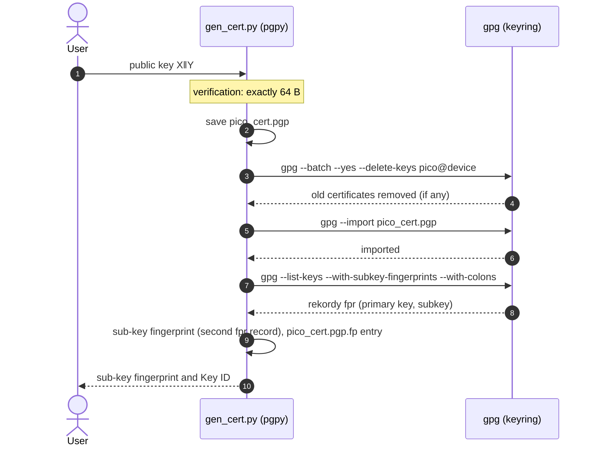
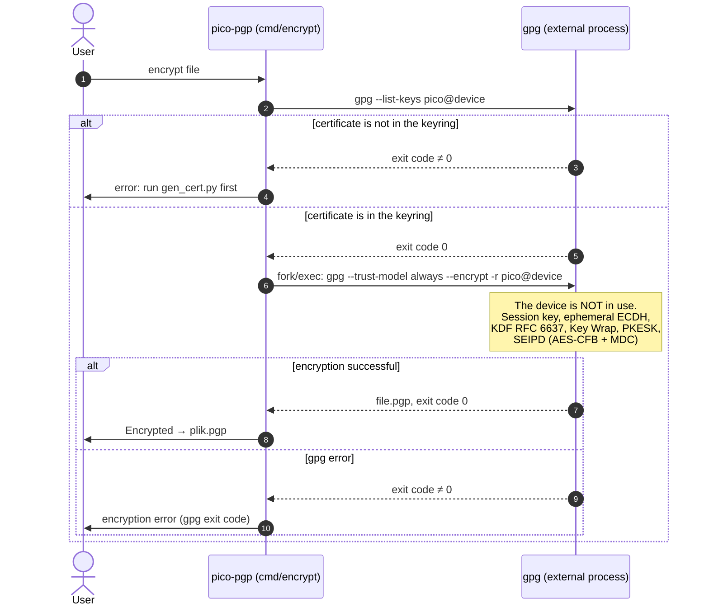
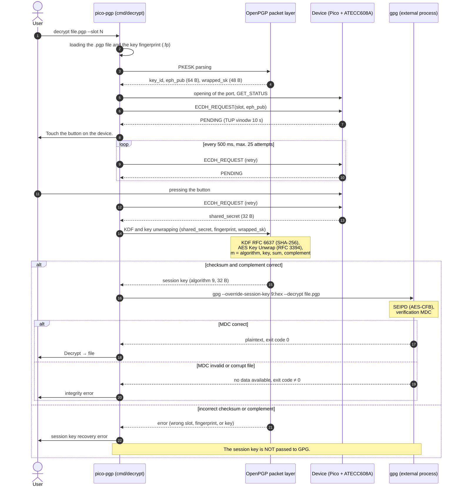

# Integration with the OpenPGP format

This document describes how `pico-pgp` integrates the **OpenPGP** format with the ATECC608A hardware key: the division of tasks between GnuPG, custom code, and the chip; certificate structure; the PKESK packet format for ECDH P-256; key derivation (KDF per RFC 6637); encryption and decryption workflows; interoperability; and potential pitfalls.

## Table of Contents

- [Integration with the OpenPGP format](#integration-with-the-openpgp-format)
  - [Table of Contents](#table-of-contents)
  - [1. Premises and scope](#1-premises-and-scope)
  - [2. Division of labor: GnuPG, custom code, chip](#2-division-of-labor-gnupg-custom-code-chip)
  - [3. Certificate](#3-certificate)
    - [3.1 Certificate structure](#31-certificate-structure)
    - [3.2 Consequences of a one-time master key](#32-consequences-of-a-one-time-master-key)
    - [3.3 Certificate generation workflow](#33-certificate-generation-workflow)
  - [4. Encryption](#4-encryption)
    - [4.1 Sequence diagram](#41-sequence-diagram)
    - [4.2 Polecenie](#42-polecenie)
    - [4.3 Notes](#43-notes)
  - [5. Decryption](#5-decryption)
    - [5.1 Sequence diagram](#51-sequence-diagram)
  - [6. KDF (RFC 6637)](#6-kdf-rfc-6637)
  - [7. CLI interface](#7-cli-interface)
  - [8. Compliance and interoperability](#8-compliance-and-interoperability)
  - [9. Safety analysis](#9-safety-analysis)
  - [10. Possible extensions](#10-possible-extensions)
  - [Powiązane dokumenty](#powiązane-dokumenty)

---

## 1. Premises and scope

- **The format is standard OpenPGP.** The `.pgp` file is a standard message containing PKESK and SEIPD packets. The only custom elements are certificate generation from the chip's key and decryption using hardware-based ECDH.
- **Encryption does not require the device.** It is performed by GnuPG using a certificate constructed from the chip's public key.
- **The private key never leaves the ATECC608A.** The chip performs a single operation: ECDH P-256.
- **Comparison purpose.** The PGP path uses the same chip operation and USB protocol as the age path. Consequently, differences in results stem from the **format and KDF**, not the hardware. See [`age-integration.md`](age-integration.md).
- The scope does not include full compatibility with the GnuPG ecosystem (signatures, web of trust, agent).

## 2. Division of labor: GnuPG, custom code, chip

| Step | Performer | Notes |
|---|---|---|
| P-256 key generation | ATECC608A | `GenKey`, key does not leave the chip |
| Certificate construction from public key | `gen_cert.py` (pgpy 0.6.0) | Input: `X‖Y` (128 hex characters). Software-based master key and one-time key; ECDH subkey using the device's point |
| Certificate import and fingerprint reading | `gen_cert.py` calls `gpg` | `gpg --import`, `--list-keys --with-subkey-fingerprints --with-colons`, save to `pico_cert.pgp.fp` |
| Session key selection, SEIPD encryption, MDC | GnuPG | Full symmetric cryptography |
| Ephemeral ECDH, KDF, AES Key Wrap during encryption | GnuPG | No custom cryptography |
| PKESK parsing | Custom code (C) | `eph_pub` and encrypted session key |
| ECDH with private key | ATECC608A | Single operation, requires TUP |
| OpenPGP KDF | Custom code (C) + `mbedtls_sha256` | Byte concatenation |
| AES Key Unwrap | `mbedtls_nist_kw` | RFC 3394, no custom cryptography |
| SEIPD decryption, MDC verification | GnuPG (`--override-session-key`) | Custom code passes the recovered session key |

**Custom code:** PKESK parser (a few hundred lines), KDF concatenation (a dozen or so lines), USB protocol handling. **Custom symmetric cryptography: 0 lines.**

## 3. Certificate

The `gen_cert.py` script (Python, pgpy 0.6.0) generates a certificate enabling encryption to the device's chip-based key. The script constructs the certificate from the device's public key, imports it into the GnuPG keyring, and saves the fingerprint required for decryption.

### 3.1 Certificate structure

The certificate has the structure of a standard OpenPGP key with a **software master key** and a **hardware encryption subkey**:

| Element | Content | Source |
|---|---|---|
| **Primary key** | ECDSA P-256 (algorithm 19), **random, script-generated**, flags: signing and certification | `PGPKey.new(ECDSA, NIST_P256)` |
| **User ID** | `Pico Device <pico@device>` | `PGPUID.new('Pico Device', email='pico@device')` |
| **User ID self-signature** (class `0x13`) | signed by primary key, SHA-256. Preferences: cipher **AES-256** (9), hash **SHA-256** (8), *features*: MDC. Key flags: signing | `add_uid(..., usage={Sign}, hashes=[SHA256], ciphers=[AES256])` |
| **Encryption subkey** | ECDH P-256 (algorithm 18), **point `X‖Y` from device** inserted in place of the generated one | `PGPKey.new(ECDH, NIST_P256)` and overwriting `keymaterial.p.x`, `keymaterial.p.y` |
| **Subkey binding signature** (class `0x18`) | signed by primary key, key flags: encrypting communications | `add_subkey(..., usage={EncryptCommunications})` |
| Expiration | none | not set |
| Creation time | moment of script execution (embedded in the fingerprint) | default |

The result is the export of the public key, saved as `pico_cert.pgp`. In the GnuPG keyring, it appears as `pub nistp256 [SC]` and `sub nistp256 [E]`, and `gpg --check-sigs` reports two valid self-signatures.

**Script input:** the public key `X‖Y` as a 128-character hexadecimal string, provided as an argument, via in response to a prompt. To obtain the public key, run the `./pico-pgp export-pubkey --slot N [--port /dev/ttyACM0]` command, which retrieves and displays the public key from the physical key.

> **Why the primary key is synthetic.** The key on the chip is an ECDH key and is not used for signing. However, OpenPGP requires a certificate self-signature; a temporary primary key is created for this purpose. This ensures the certificate is formally valid, includes algorithm preferences, and can be imported without warnings about a missing self-signature.

### 3.2 Consequences of a one-time master key

The private part of the master key **is not saved anywhere**, because the script exports only `key.pubkey` and terminates. Consequences:

| Effect | Description |
|---|---|
| The certificate is "write-once" | it cannot be modified later: you cannot add a User ID, extend validity, change preferences, or sign anything |
| No revocation capability | no revocation certificate is generated. The only form of "revocation" is deleting the certificate from the keyring |
| Identity is not authenticated | signing with the primary key does not prove that the certificate belongs to a specific device. Anyone can create a certificate with the same User ID and a different subkey. Verification relies on the subkey **fingerprint**, not the User ID |
| Rerunning the script | creates a **new** primary key and a new subkey with a new creation timestamp—resulting in a **new fingerprint** |

The certificate should not be published on keyservers.

### 3.3 Certificate generation workflow



The script does not communicate with the device. Retrieving the public key from the chip is performed as a separate step.

## 4. Encryption

### 4.1 Sequence diagram



### 4.2 Polecenie

```bash
gpg --trust-model always --encrypt -r pico@device --output plik.pgp --batch --yes plik
```

| Option | Purpose |
|---|---|
| `--trust-model always` | skips trust evaluation (the User ID has `unknown` status because the primary key is ephemeral and trust has not been set) |
| `-r pico@device` | recipient: device key |
| `--batch --yes` | non-interactive mode, overwrite output file |

### 4.3 Notes

- **The device is not used.** GnuPG performs all cryptographic operations.
- `pico-pgp encrypt` checks for the presence of the `pico@device` key in the keyring and then executes the command shown above. The filename must not be passed to the shell in a way that allows command injection.

## 5. Decryption

### 5.1 Sequence diagram



The diagram simplifies the chronology: the button is pressed during a retry loop, and the loop ends when the device returns a result instead of `PENDING`.

## 6. KDF (RFC 6637)

```
Z      = X-coordinate of the ECDH point (32 B for P-256)         ← result of ECDH_REQUEST
Param  = len(OID) ‖ OID ‖ 12 ‖ 03 ‖ 01 ‖ hash ‖ sym ‖ "Anonymous Sender    " ‖ fingerprint
KEK    = first L bytes of SHA-256( 00 00 00 01 ‖ Z ‖ Param )
L = length of the symmetric encryption key: AES-128 → 16 B, AES-256 → 32 B
```

Values:

| Element | Value |
|---|---|
| `OID` (nistp256) | `2A 86 48 CE 3D 03 01 07` (8 B), preceded by length `08` |
| `12` | key algorithm: 18 (ECDH) |
| `03 01` | length and reserved byte of KDF parameters |
| `hash` | `08` (SHA-256): byte from KDF parameters in the subkey packet |
| `sym` | **`07` (AES-128)** in the certificate from `gen_cert.py`: byte from KDF parameters in the subkey packet |
| `"Anonymous Sender    "` | 20 ASCII bytes: the string `Anonymous Sender` (16 characters) and 4 trailing spaces |
| `fingerprint` | 20 B fingerprint of the encryption **subkey** |

The entire `Param` structure is **54 B**. For the certificate generated by `gen_cert.py`, the `KEK` is **16 B** (the first 16 bytes of the hash), not 32.

> **The `hash` and `sym` parameters are derived from the certificate.** The subkey packet contains the four bytes `03 01 hash sym`. A certificate generated by `pgpy` for P-256 has `03 01 08 07`, representing **SHA-256 and AES-128** as the key-wrapping cipher. GnuPG uses exactly these values ​​for encryption, so the client must use the same ones.

## 7. CLI interface

| Command | Description |
|---|---|
| `export-pubkey --slot N [--port /dev/ttyACM0]` | export public key from Pico slot |
| `pico-pgp encrypt <file> [--port /dev/ttyACM0]` | encrypts via GnuPG to `<file>.pgp` |
| `pico-pgp decrypt <file.pgp> [--slot N] [--port /dev/ttyACM0]` | decrypts via hardware ECDH |

Correctly handled errors include: device missing, `pico@device` key missing from the keyring, fingerprint file missing, TUP timeout, incorrect session key checksum or padding (wrong slot or fingerprint), and MDC error reported by GnuPG.

Unlike `pico-crypt`, **the slot is not stored in the file** (the OpenPGP format has no provision for this). The user specifies it during decryption (defaulting to 0) as an argument; it must match the slot of the public key provided when the certificate was created.

## 8. Compliance and interoperability

| Scenario | Result |
|---|---|
| File from `pico-pgp encrypt` / `gpg --list-packets` | Standard PKESK algorithm 18 + SEIPD; recognized by any OpenPGP tool |
| Decryption with standard `gpg -d` | **Does not work** (private key missing from keyring). Decryption requires `pico-pgp` |
| Importing the certificate into other implementations (Sequoia, OpenPGP.js, RNP) | Certificate has valid self-signatures, so import is likely, though untested. Trust must be set manually |
| File encrypted with an earlier version of the certificate (different fingerprint) | `pico-pgp decrypt` requires the corresponding `.fp` file |
| Compatibility with files from `gpg --override-session-key` | Applies only to SEIPD decryption |

**The certificate should not be published** on keyservers: the master key is intended for one-time use, meaning the certificate cannot be revoked or updated, and the User ID is unauthenticated. It is used for local encryption and for exchange between trusted parties who will verify the subkey fingerprint.

## 9. Safety analysis

| Property | Consequence in `pico-pgp` |
|---|---|
| AES-CFB + MDC (SHA-1) | Vulnerable to manipulation if the exit code is mishandled. The MDC must be verified before data is returned; GnuPG performs this verification. |
| Plaintext Key ID in PKESK | Reveals the recipient (device key identification). |
| Compression before encryption | Risk of compression oracle attacks in data injection scenarios. |
| Complex parser | Custom PKESK parser supports only version 3, algorithm 18, the P-256 curve, and fixed-length packets. |
| Cryptographic agility | The session key cipher is determined by self-signature preferences (AES-256), though GnuPG continues to support other algorithms. |

**Risks arising from the integration design:**

| Risk | Description | Mitigation |
|---|---|---|
| Session key in process arguments | visible in `ps` | use file descriptor variant |
| Command injection via filename | `system()` with concatenated command | `execvp` with argument array |
| Ephemeral master certificate key | no revocation or updates, unauthenticated User ID, new fingerprint upon regeneration | copy `.pgp` and `.fp`, verify subkey fingerprint |
| Fingerprint mismatch with certificate | KDF yields different key, `unwrap` fails | read fingerprint from GnuPG after import |
| `--trust-model always` | bypasses trust evaluation | use only for device certificate, not globally |
| `shared_secret` exposed over USB | see architecture | [`security-model.md`](security-model.md) |

The design utilizes the standard OpenPGP mechanism, so it does not introduce a new format, unlike `pico-p256` in the age ecosystem.

## 10. Possible extensions

- **Preservation of the certificate's master key** (e.g., in an encrypted offline file) to enable certificate revocation, renewal, and updating.
- **Reproducible fingerprint:** fixed certificate creation time (e.g., the `created` parameter in pgpy, if available) so that regenerating the certificate for the same key on the chip yields the same fingerprint.
- **Passing the session key via a file descriptor** instead of a process argument.
- **Using `execvp` instead of `system()`** when invoking GnuPG.
- **Storing the certificate in the chip's slot 8** (`WRITE_DATA`/`READ_DATA`) as a portable device identifier.

---

## Powiązane dokumenty

- [`architecture.md`](architecture.md): components, client layers, and design decisions
- [`age-integration.md`](age-integration.md): analogous integration for the `age` format
- [`protocol.md`](protocol.md): `ECDH_REQUEST`, TUP, `GET_PUBLIC_KEY`
- [`security-model.md`](security-model.md): threats and format analysis
- [`limitations.md`](limitations.md): OpenPGP path limitations
- [`reproducibility.md`](reproducibility.md): builds, tests, and benchmarks